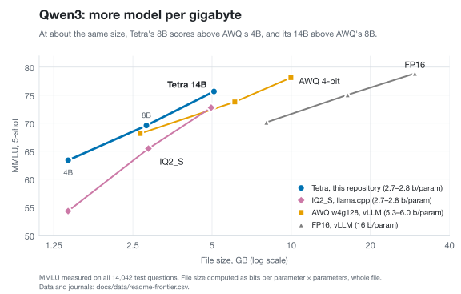
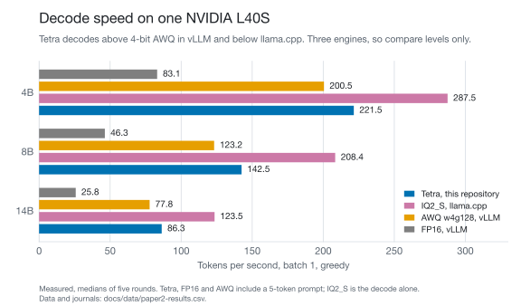
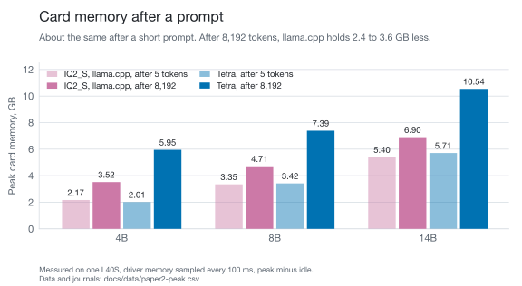

<picture>
  <source media="(prefers-color-scheme: dark)" srcset="docs/brand/svg/tetra-lockup-on-dark.svg">
  
</picture>

# Tetra: LLVQ in Rust

[](https://arxiv.org/abs/2609.35465)
[](https://doi.org/10.5281/zenodo.22133606)
[](https://www.rust-lang.org)
[](llvq-cuda/)
[](llvq-metal/)
[](https://huggingface.co/Pier-Jean)
[](https://pypi.org/project/llvq-tetra/)
[](#licence)

An independent Rust implementation of Leech-lattice vector quantization for LLM weights
([arXiv:2603.11021](https://arxiv.org/abs/2603.11021), Qualcomm AI Research, 2026). The core crates (lattice, search,
indexing, GPTQ, file format) have no external dependency. Fused CUDA and Metal kernels read the 2-bit codes inside
the model without ever building a dense matrix.

Two families are published: three dense Qwen3 models, and Inkling 2 Mini, a 26.4-billion-parameter mixture of
experts. The `llvq` runtime pulls and serves them, with an OpenAI-compatible route and an Ollama-compatible one.

```bash
curl -fsSL https://github.com/pjmalandrino/llvq-tetra/releases/latest/download/install.sh | sh
llvq run inkling2:mini
```

The site, with one page a model and short guides on quantization and card memory:
[pjmalandrino.github.io/llvq-tetra](https://pjmalandrino.github.io/llvq-tetra/).

How it works, from the Golay code to the one-launch CUDA token: [`docs/how-it-works.md`](docs/how-it-works.md).

## Inkling 2 Mini, a mixture of experts

[Inkling 2 Mini](https://huggingface.co/thinkingmachines/Inkling-2-Mini) has 3,072 experts in 24 layers, 8 routed
per token, and its middle layers run three times. Each expert is stored as Tetra codes and stays compressed on the
card: the kernel decodes and multiplies the routed experts' rows in a few launches a layer. The file is
[Pier-Jean/Inkling-2-Mini-LLVQ-Tetra](https://huggingface.co/Pier-Jean/Inkling-2-Mini-LLVQ-Tetra), text only.

| | NVIDIA L40S | NVIDIA L4 | Apple M3 Max, Metal |
|---|---|---|---|
| decode after a 32-token prompt | 72.2 tok/s | 36.9 tok/s | 27.7 tok/s |
| decode after a 2,000-token prompt | 67.9 tok/s | not measured | 26.2 tok/s |
| decode after a 9,000-token prompt | 62.1 tok/s | 31.2 tok/s | not measured |
| device memory after load | 8.39 GB | 8.13 GB | 8.03 GB |
| peak device memory reading a 9,000-token prompt | 12.0 GB | 11.5 GB | not measured |
| time to read a 9,000-token prompt | 23.9 s | 77.1 s | not measured |

- Size: 8.15 GB to download, 2.47 bits per parameter for the whole text model, tables included, *computed* from
  the files. The native model is 19.5 GB.
- Quality: KL 0.0880 nats against the native model on WikiText-2. GSM8K, first 200 problems: 191 through the dense
  reference path and 186 through the fused kernels, not separated (p = 0.18). The native model was not run through
  our GSM8K harness.
- All *measured* on 2026-11-22 to 2026-11-24, batch 1; journals in
  [inkling-cuda-ttft](docs/mesures/inkling-cuda-ttft-2026-11-24.txt) and, for the Mac,
  [inkling-debit-boucle](docs/mesures/inkling-debit-boucle-2026-11-22.txt); history in
  [`docs/data/inkling-stats.csv`](docs/data/inkling-stats.csv). The three machines are not to be divided by one another.
- The Mac column is the bench binary on a 64 GB M3 Max, measured before the long-prompt work: its prompt path has
  none of it yet, and the runtime has not served Inkling 2 Mini on a Mac.
- Not done: no run on a 16 GB consumer card, no vision tower, no comparison with other 2-bit files of this model
  through this engine. Reading a long prompt for the first time is slow; a follow-up turn reuses the cache.

## Results on Qwen3

Three Qwen3 models, sealed at about 2.7 bits per parameter and served on one NVIDIA L40S.

| model | b/param | MMLU | GSM8K | WikiText-2 ppl | tok/s | GB weights on card |
|---|---|---|---|---|---|---|
| Qwen3-4B | 2.73 | 63.37 | 82.49 | 12.58 | 221.5 | 1.38 |
| Qwen3-8B | 2.70 | 69.58 | 88.63 | 9.71 | 142.5 | 2.76 |
| Qwen3-14B | 2.73 | 75.66 | 92.04 | 8.44 | 86.3 | 5.04 |

**Quality for the memory.** At about the same size, our 8B scores above AWQ's 4B, and our 14B above AWQ's 8B.
Model for model, we lose to 4-bit AWQ, which needs about twice the bits, and we beat llama.cpp's IQ2_S, which needs
the same.

<picture>
  <source media="(prefers-color-scheme: dark)" srcset="docs/figures/frontier-dark.svg">
  
</picture>

Paired gaps on the same questions, our file minus the baseline, in points with 95 % intervals:

| model | MMLU vs AWQ 4-bit | GSM8K vs AWQ 4-bit | MMLU vs IQ2_S | GSM8K vs IQ2_S |
|---|---|---|---|---|
| Qwen3-4B | -4.76 [-5.49, -4.02] | -6.52 [-8.65, -4.39] | +9.08 [+8.19, +9.97] | +14.25 [+11.65, +16.86] |
| Qwen3-8B | -4.21 [-4.86, -3.54] | -4.32 [-5.81, -2.83] | +4.13 [+3.37, +4.88] | +3.03 [+1.10, +4.96] |
| Qwen3-14B | -2.46 [-3.00, -1.92] | -3.34 [-4.55, -2.12] | +2.89 [+2.26, +3.52] | +0.15 [-1.27, +1.58] |

Both losses to AWQ shrink with size. Against IQ2_S the 14B GSM8K is not separated. Each GSM8K pair crosses two
engines.

**Speed.** One CUDA launch a token decodes the 4B at 221.5 tokens per second, 1.72 times the speed of one launch
per matrix, with the same tokens. That is above AWQ in vLLM and below llama.cpp.

<picture>
  <source media="(prefers-color-scheme: dark)" srcset="docs/figures/speed-dark.svg">
  
</picture>

**Memory after a long prompt.** This is where llama.cpp is ahead. After 8,192 prompt tokens our files hold 2.4 to
3.6 GB more card memory than IQ2_S.

<picture>
  <source media="(prefers-color-scheme: dark)" srcset="docs/figures/memory-dark.svg">
  
</picture>

What the numbers are:

- Every figure is *measured*, except bits per parameter and the weights on the card, *computed* from the files. Each
  point's journal is in the CSV its figure names; `uv run ops/readme_figure.py` redraws the three figures.
- MMLU is 5-shot on all 14,042 test questions, GSM8K zero-shot on its 1,319. Speed is batch 1, greedy, 256 tokens
  after a 5-token prompt, median of five rounds.
- The MMLU gaps against AWQ are *computed* from the paired answers (`docs/data/paper2-gaps.csv`); the other gaps are
  *measured* (`docs/data/paper2-gsm8k-gaps.csv`, [duel-iq2](docs/mesures/duel-iq2-2026-11-08.txt)).
- The first figure counts the whole file, 1.42, 2.82 and 5.09 GB, where the table counts the weights on the card.
- The scores were measured under an earlier attention form. The served form returns the same tokens as one launch
  per matrix and stays within ±0.12 % of that form's perplexity.
- The speed is an L40S result. On an A100, launched once per matrix, our files decode slower than FP16 in vLLM.

The paper has the full comparison, the limits and the record of predictions:
[arXiv:2609.35465](https://arxiv.org/abs/2609.35465), source in [`paper2/`](paper2/README.md). The served
configuration and the open decisions are in [`docs/ETAT.md`](docs/ETAT.md).

## Run it

The `llvq` runtime installs from a prebuilt archive. Nothing to compile, and no CUDA toolkit: the archive carries
the CUDA libraries it loads.

```bash
curl -fsSL https://github.com/pjmalandrino/llvq-tetra/releases/latest/download/install.sh | sh
llvq run inkling2:mini                # 8.15 GB, checked against its pinned sha256
llvq run qwen3:4b "Name three primary colours."
llvq serve                            # OpenAI and Ollama routes on 127.0.0.1:11435, tool calls included
```

| system | needs |
|---|---|
| Linux x86_64, NVIDIA | driver 550 or newer, a card of compute capability 8.9 or newer (RTX 40 series, L4, L40S and later), glibc 2.35 (Ubuntu 22.04), OpenSSL 3 |
| macOS, Apple Silicon | nothing else |

Through the runtime, Inkling 2 Mini has been run on NVIDIA cards only; on a Mac it was measured in the bench
binary, at 27.7 tok/s.

The files are on the Hugging Face Hub, in two collections:
[LLVQ Tetra - Thinking Machines](https://huggingface.co/collections/Pier-Jean/llvq-tetra-thinking-machines) and [LLVQ Tetra - Qwen](https://huggingface.co/collections/Pier-Jean/llvq-tetra-qwen).
A different hash is a different file.

| model | repository | file | SHA-256 |
|---|---|---|---|
| Inkling 2 Mini | [Pier-Jean/Inkling-2-Mini-LLVQ-Tetra](https://huggingface.co/Pier-Jean/Inkling-2-Mini-LLVQ-Tetra) | `llvq-files.json`, the index of 29 files | `1e9314db…` |
| Qwen3-4B | [Pier-Jean/Qwen3-4B-LLVQ-Tetra-sealed](https://huggingface.co/Pier-Jean/Qwen3-4B-LLVQ-Tetra-sealed) | `qwen3-4b-sealed.bin` | `886391a8…` |
| Qwen3-8B | [Pier-Jean/Qwen3-8B-LLVQ-Tetra-sealed](https://huggingface.co/Pier-Jean/Qwen3-8B-LLVQ-Tetra-sealed) | `qwen3-8b-sealed-B.bin` | `7bdb9a55…` |
| Qwen3-14B | [Pier-Jean/Qwen3-14B-LLVQ-Tetra-sealed](https://huggingface.co/Pier-Jean/Qwen3-14B-LLVQ-Tetra-sealed) | `qwen3-14b-sealed.bin` | `61db37fe…` |

The container is this repository's own format; no other runtime reads it. The runtime is documented in
[`llvq-runtime/`](llvq-runtime/README.md). To build it from source instead, with a CUDA toolkit 12.x on Linux:

```bash
git clone https://github.com/pjmalandrino/llvq-tetra && cd llvq-tetra
cargo build --release -p llvq-runtime --features cuda    # Linux; --features metal on a Mac
target/release/llvq pull qwen3:4b
```

On CUDA the runtime serves the v9 configs, greedy only. On a Mac it runs the Rust Metal engine; the faster MLX door
for the 4B is `ops/llvq-mlx chat` ([`docs/plan-metal-debit.md`](docs/plan-metal-debit.md)).

Perplexity of the 4B (12.5834 on an L40S, token fingerprint `3f1baca9033bf251`):

```bash
LLVQ_DTYPE=f16 cargo run --release -p llvq-llm --features cuda --bin ppl -- 4096 12 cuda qwen3-4b-sealed.bin
```

### In `transformers`

The 4B is also published as compressed safetensors,
[Pier-Jean/Qwen3-4B-LLVQ-Tetra](https://huggingface.co/Pier-Jean/Qwen3-4B-LLVQ-Tetra), read by the
[`llvq-tetra`](https://pypi.org/project/llvq-tetra/) package ([`llvq-tetra/`](llvq-tetra/README.md)).

```bash
pip install llvq-tetra
```

```python
import llvq_tetra  # registers the method; without it, transformers loads a random model and does not raise
from transformers import AutoModelForCausalLM, AutoTokenizer

name = "Pier-Jean/Qwen3-4B-LLVQ-Tetra"
tok = AutoTokenizer.from_pretrained(name)
model = AutoModelForCausalLM.from_pretrained(name, dtype="float32")
```

It gives the same 256 greedy tokens as our engine (*measured*,
[hf-testpypi](docs/mesures/hf-testpypi-4b-2026-10-07.txt)).

### Paper 1's file

The earlier `Planes14` 4B of release `v0.0.1` stays at
[Pier-Jean/Qwen3-4B-LLVQ-2bit](https://huggingface.co/Pier-Jean/Qwen3-4B-LLVQ-2bit). Its numbers are in
[`docs/fiche-4b.md`](docs/fiche-4b.md), its runbook in [`LAUNCH_ME.md`](LAUNCH_ME.md), and the reviewer notes in
[`ARTIFACT-EVALUATION.md`](ARTIFACT-EVALUATION.md).

## Repository map

| crate | role |
|---|---|
| `llvq-core` | Golay code, Leech lattice, shells |
| `llvq-search` | nearest-point search, the v1 index, the Tetra word and encoder |
| `llvq-quant` | GPTQ and the block loop; `faer` behind `fast-linalg` |
| `llvq-artifact` | the `.llvq` container and its VRAM transcoding |
| `llvq-bench` | rate-distortion and decode-cost benches |
| `llvq-metal` | macOS GPU shaders and benches |
| `llvq-cuda` | CUDA kernels, 4E, benches (Linux) |
| `llvq-llm` | Qwen3 and Inkling 2 forward passes, served configs, perplexity, MMLU, GSM8K |
| `llvq-runtime` | the `llvq` binary: pull, run, serve, with OpenAI and Ollama routes |

The first five have no external dependency and forbid `unsafe`. Feature flags: `metal`, `cuda` (NVRTC at startup),
`fast-linalg` (needed in practice to quantize: the dependency-free path is 40 times slower, bit for bit the same).
Every binary and switch is listed in [`CLAUDE.md`](CLAUDE.md). `cargo test` is the fast loop.

## Documents

- [`docs/how-it-works.md`](docs/how-it-works.md): the maths, the lattice, the format and the kernel.
- [`docs/ETAT.md`](docs/ETAT.md): served configuration, numbers, open decisions.
- [`docs/ROADMAP.md`](docs/ROADMAP.md): what comes next.
- [`docs/METHODE.md`](docs/METHODE.md): the lab rules. [`docs/README.md`](docs/README.md): every other document.
- [`paper2/`](paper2/README.md): *Tetra: Serving Leech-Lattice Quantized LLMs at 2.7 Bits per Parameter*, on
  [arXiv:2609.35465](https://arxiv.org/abs/2609.35465).
- [`paper/`](paper/README.md): *Decoding the Leech Lattice at Matvec Speed: Fused Kernels and VRAM Layouts for 2-Bit
  LLM Inference*, paper 1, on Zenodo ([10.5281/zenodo.22133606](https://doi.org/10.5281/zenodo.22133606)).

## Method

Every paid experiment is preregistered in [`proofs/`](proofs/) with its kill criterion and a signed prediction, before
the first measurement, and most preregistrations are stamped with OpenTimestamps. Deviations go in a companion
`-ECARTS.md`, wrong predictions included. Every number carries a label, *measured*, *computed* or *estimated*, and a
link to its journal in [`docs/mesures/`](docs/mesures/). Raw outputs are committed. Speeds from two engines are never
divided.

## Licence

Code: MIT OR Apache-2.0. The Qwen3 forward pass in `llvq-llm/src/model.rs` is derived from
[candle-transformers](https://github.com/huggingface/candle) (MIT OR Apache-2.0). The published models are Apache 2.0,
inherited from Qwen3 and from Inkling 2 Mini, whose use is also bound by Thinking Machines'
[Model Acceptable Use Policy](https://thinkingmachines.ai/model-acceptable-use-policy/). The QTIP kernel used in one bench is GPL v3 upstream and is not redistributed
([`docs/qtip-provenance.md`](docs/qtip-provenance.md)).
